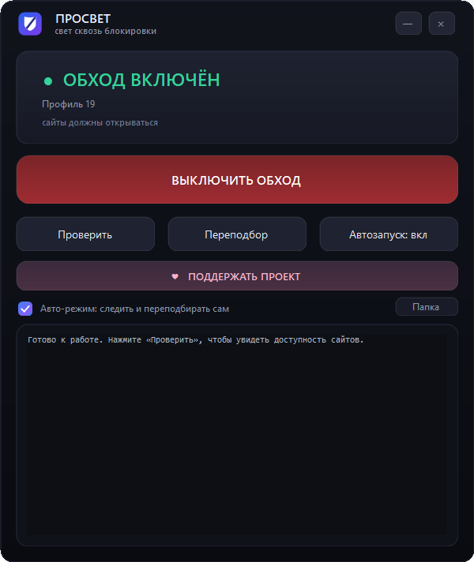

# Prosvet

## [⬇ Download ProsvetSetup.exe](https://github.com/Niki113/prosvet/releases/latest/download/ProsvetSetup.exe)

**Windows 10/11 x64 · 2.2 MB · free · no account needed**

🇬🇧 **English** · [🇷🇺 Русский](README.ru.md)

---

DPI bypass for Windows. No subscriptions, no accounts, no telemetry.

The app picks a working bypass strategy on its own: it tries 27 profiles,
tests each one like a browser (HTTP/2) and keeps the one that actually opens
websites. If your ISP changes something, it re-tunes automatically.



## Install

1. Download `ProsvetSetup.exe` using the button above
2. Run it and press "Install" (UAC prompt)
3. Done — a shortcut appears on your desktop

Windows may warn that the publisher is unknown — that is normal for a free
unsigned installer. Click "More info" → "Run anyway".

## Features

- One-click on/off
- Automatic strategy selection: 27 profiles + 8 built-in techniques
- Auto mode: watches the engine and site availability, heals itself
- Starts with Windows, plus a watchdog every 5 minutes
- Availability check for 6 sites with retries, like a browser does
- Lives in the system tray, keeps a log of everything
- Self-update from GitHub Releases

## How it works

The app does not encrypt traffic and does not change your IP — it is not a VPN.
It intercepts the first packets of a connection through the WinDivert driver
and splits/spoofs the TLS ClientHello so that the ISP's equipment fails to
recognise the destination, while the server still understands the request.

Filter: TCP 80/443, UDP 443 (QUIC). Address lists come from community sets.

## Limitations

- **Instagram, Facebook** — blocked by server IP, a tunnel is required
- **Telegram** — datacenters are blocked by IP; DPI tricks cannot help
- **Game ping** is not improved: the tool does not change routing

## Updates

Once a day the app reads `version.json` from this repository. If a newer
version exists, a line "update available" appears in the window; one click
downloads the installer, verifies its SHA-256 and installs it silently.

## Support

The project is free and has no ads. If it saves you time:

- [DonationAlerts](https://www.donationalerts.com/r/niki_13_13)
- [SBP or card](https://pay.cloudtips.ru/p/483fad75)

## Build from source

Only .NET Framework 4.x (ships with Windows) and `csc.exe` are needed:

```powershell
powershell -ExecutionPolicy Bypass -File build.ps1
```

The result is `dist/Просвет.exe`.

## Credits and licenses

This project stands on other people's work:

- **zapret** — [bol-van/zapret](https://github.com/bol-van/zapret), MIT
- **profile set** — [Flowseal/zapret-discord-youtube](https://github.com/Flowseal/zapret-discord-youtube), MIT
- **WinDivert** — [basil00/WinDivert](https://github.com/basil00/WinDivert), LGPLv3 / GPLv2

License texts and notices are in [THIRD-PARTY-NOTICES.md](THIRD-PARTY-NOTICES.md).
The application's own code is MIT, see [LICENSE](LICENSE).

## Disclaimer

The software only affects your own traffic on your own machine. Use it in
compliance with the laws of your country. The author is not responsible for
how you apply it.
