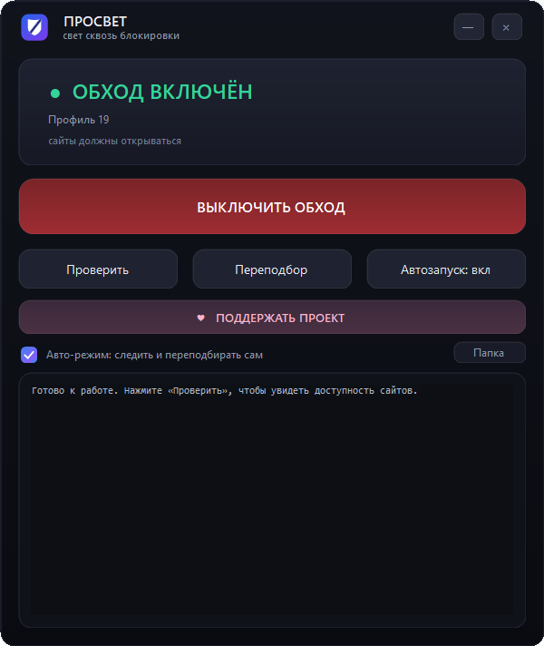

# Просвет

## [⬇ Скачать ProsvetSetup.exe](https://github.com/Niki113/prosvet/releases/latest/download/ProsvetSetup.exe)

**Windows 10/11 x64 · 2,2 МБ · бесплатно · без регистрации**

[🇬🇧 English](README.md) · 🇷🇺 **Русский**

---

Обход DPI-блокировок для Windows. Без подписок, аккаунтов и телеметрии.

Программа подбирает рабочую стратегию обхода автоматически: перебирает
27 профилей, проверяет каждый как браузер (HTTP/2) и оставляет тот,
который реально открывает сайты. Если провайдер что-то поменял —
переподбирает сама.



## Установка

1. Скачайте `ProsvetSetup.exe` кнопкой выше
2. Запустите, нажмите «Установить» (окно UAC)
3. Готово — ярлык появится на рабочем столе

Windows может предупредить, что издатель неизвестен — это нормально для
бесплатного установщика без платной подписи. Нажмите «Подробнее» →
«Выполнить в любом случае».

## Что умеет

- Включение и выключение обхода одной кнопкой
- Автоподбор стратегии из 27 профилей + 8 собственных техник
- Авто-режим: следит за движком и доступностью сайтов, чинит сам
- Автозапуск вместе с Windows + сторожевой таймер каждые 5 минут
- Проверка доступности 6 сайтов с повторами, как в браузере
- Сворачивается в трей, журнал всех действий в окне
- Автообновление с GitHub Releases

## Как это работает

Программа не шифрует трафик и не меняет ваш IP — это не VPN.
Она перехватывает первые пакеты соединения через драйвер WinDivert и
раздробляет/подменяет TLS-приветствие так, чтобы оборудование
провайдера не распознало имя сайта, а сервер всё понял правильно.

Фильтр: TCP 80/443, UDP 443 (QUIC). Списки адресов — из открытых
наборов сообщества.

## Ограничения

- **Instagram, Facebook** — блокировка по адресу сервера, нужен туннель
- **Telegram** — серверы блокируются по IP, DPI-обход тут бессилен
- **Пинг в играх** не снижается: обход не меняет маршрут

## Обновления

Программа раз в сутки читает `version.json` из этого репозитория.
Если версия новее — в окне появляется строка «доступно обновление»,
по клику скачивается установщик, сверяется SHA-256 и ставится тихо.

## Поддержать

Проект бесплатный и без рекламы. Если он экономит вам время:

- [DonationAlerts](https://www.donationalerts.com/r/niki_13_13)
- [СБП или карта](https://pay.cloudtips.ru/p/483fad75)

## Сборка из исходников

Нужен только .NET Framework 4.x (входит в Windows) и `csc.exe`:

```powershell
powershell -ExecutionPolicy Bypass -File build.ps1
```

Готовый `Просвет.exe` появится в `dist/`.

## Благодарности и лицензии

Проект стоит на работе других людей — без них ничего бы не было:

- **zapret** — [bol-van/zapret](https://github.com/bol-van/zapret), MIT
- **сборка профилей** — [Flowseal/zapret-discord-youtube](https://github.com/Flowseal/zapret-discord-youtube), MIT
- **WinDivert** — [basil00/WinDivert](https://github.com/basil00/WinDivert), LGPLv3 / GPLv2

Тексты лицензий и уведомления — в [THIRD-PARTY-NOTICES.md](THIRD-PARTY-NOTICES.md).
Собственный код приложения — MIT, см. [LICENSE](LICENSE).

## Дисклеймер

Программа меняет только ваш собственный трафик на вашем компьютере.
Используйте её в рамках закона вашей страны. Автор не несёт
ответственности за то, как вы её применяете.
